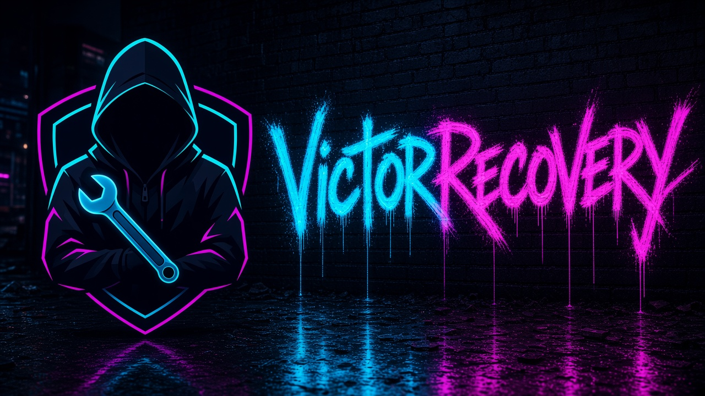

# VictorRecovery

**A TWRP-based custom recovery for safe flashing, rollback and backups (experimental).**

  
  
  
  

<a href="https://victorious-framework.pages.dev">Victorious Framework</a>

---

A TWRP-based custom Android recovery by Victorious93, focused on safe flashing, rollback, flash lists, NetHunter-friendly updates and backups to a PC or Raspberry Pi.

> **Status: experimental, planning and scaffolding only.** No working build exists yet and nothing has been tested on a device. A CI workflow skeleton for a OnePlus 7T build exists but is untested. No build will be described as booting until it has been tested on that device.

## ⚠️ Warnings: read before you use any build

- **You can brick your phone.** Flashing a recovery, kernel or ROM can leave a device unbootable. Keep a full backup and your current boot/recovery images on a PC before you start.
- **You need an unlocked bootloader.** Unlocking **erases all data**, may void the warranty, and can disable some apps (banking, DRM, Play Integrity).
- Test with `fastboot boot` (temporary boot) first wherever the device supports it, before installing permanently.
- Only flash builds made for your exact device codename. Check it with `adb shell getprop ro.product.device`.
- You use this software at your own risk. No warranty (see LICENSE).

## Planned devices
1. OnePlus 7T (`hotdogb`), Kali NetHunter compatible
2. Nexus 6 (`shamu`)
3. Nexus 6P (`angler`)
4. OnePlus Nord 5G (`avicii`, to be confirmed)

## Related repositories
- [VictorRecovery-Companion](https://github.com/Victorious93/VictorRecovery-Companion): Android app (skeleton)
- [android_device_oneplus_hotdogb_victorrecovery](https://github.com/Victorious93/android_device_oneplus_hotdogb_victorrecovery): 7T device tree (untested import)
- [android_bootable_recovery](https://github.com/Victorious93/android_bootable_recovery): fork of TeamWin's recovery

## Docs
- [Plan](PLAN.md) · [Research](docs/RESEARCH.md) · [Comparison](docs/COMPARISON.md) · [Devices](docs/DEVICES.md) · [Design](docs/DESIGN.md) · [Companion app](docs/COMPANION.md)

## Credits
- **TeamWin Recovery Project (TWRP)**: the base of VictorRecovery. https://github.com/TeamWin and https://github.com/minimal-manifest-twrp
- **OrangeFox Recovery** and **PitchBlack Recovery Project**: inspiration for features. No code from them is used at present.
- Device-tree authors whose work we build on: TeamWin / Dees_Troy (shamu, angler, sm8150-common), rany2 (avicii), sreeshankark (avicii), rabilgic (hotdogb), mauronofrio (hotdog unified).
- **BusyBox** (GPL-2.0-only), https://busybox.net. Source and build config ship with every release.
- AOSP (Apache-2.0).

---

## Victorious fleet

VictorRecovery is part of the [Victorious Framework](https://victorious-framework.pages.dev), a family of Android and PC tools by Don Victor. **Every app works standalone; fleet integrations are optional** and never required.

Related: [VictorRecovery-Companion](https://github.com/Victorious93/VictorRecovery-Companion) (fleet app), [victorious-flash](https://github.com/Victorious93/victorious-flash) (flashing tool), [VictorLaunch](https://github.com/Victorious93/victorlaunch) (fleet launcher and theme provider). The full roster lives in [victorious-fleet](https://github.com/Victorious93/victorious-fleet), and live status is in [fleet-manifest](https://github.com/Victorious93/fleet-manifest).

## Contributing

Issues and pull requests are welcome. Keep changes focused, match the existing code style, never commit secrets or release keys, and keep any fleet integration optional so the app still works on its own. Open a PR against the default branch and wait for CI to pass.

## License
Our own code: **Apache-2.0** (see [LICENSE](LICENSE)). Upstream components keep their original licences (Apache-2.0, GPL-2.0 and others). See [NOTICE](NOTICE) and [CREDITS.md](CREDITS.md).
